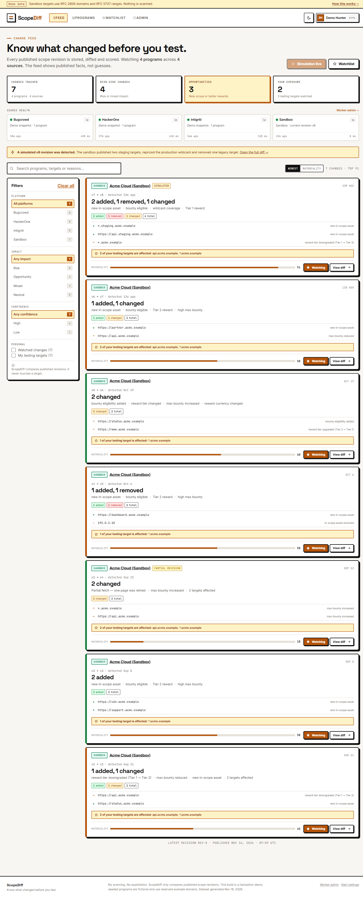

# ScopeDiff

**Know what changed before you test.**

**Live demo:** [https://scopediff.web.app](https://scopediff.web.app)

ScopeDiff watches bug bounty scopes across Bugcrowd, HackerOne and Intigriti, stores every
published revision, and tells hunters exactly what changed — added targets, removed targets,
reward changes and scope moves — with a materiality score and a Slack alert.

No scanning. No exploitation. Just published scope revisions, diffed.



## The problem

A hunter finds a promising program, spends a weekend on a target, then discovers the target
was removed or repriced days earlier. Program pages do not announce changes, changelogs are
inconsistent, and notification feeds are noisy. ScopeDiff turns a scope into an append-only
version history and surfaces the delta.

## What the demo shows

- A feed of 6 seeded changes with impact, confidence, materiality and personal-impact
  matching.
- Four fictional programs across Bugcrowd, HackerOne, Intigriti and a sandbox.
- A hidden **v8** sandbox revision. Click **Simulate scope change** and the real diff engine
  produces:
  - `*.staging.acme.example` added, Tier 1, $5,000
  - `api.staging.acme.example` added, Tier 2, $3,000
  - `*.acme.example` repriced from Tier 1 / $10,000 to Tier 3 / $2,000
  - `legacy.acme.example` removed
  - materiality **91/100**, 4 targets, mixed impact
- A full diff page with field-level before/after changes, personal-impact matching against
  the viewer's testing targets, alert status and source provenance.
- Program detail pages with current scope, version timeline and snapshot history.
- Watchlist and alert preferences, worker admin, light/dark themes and mobile layouts.

All demo targets use RFC 2606 reserved domains (`example.com`) and RFC 5737 test ranges
(`192.0.2.10`). The seeded programs are fictional. No real program ID is used.

## Live accounts, onboarding and scheduled checks

The live product path is now account-based:

- **Sign up / sign in** with Google SSO or email/password via Firebase Auth.
- **Preference wizard** on first sign-in, with clickable answers and manual testing-target input.
- **Watch a program by URL** from the Programs page. Supported links:
  - `bugcrowd.com/<handle>`
  - `hackerone.com/<handle>`
  - `app.intigriti.com/programs/<company>/<program>/detail`
- The worker fetches the first published version, stores it as a baseline, and creates a watch.
- Each watch has its own interval: **1, 5, 15 or 60 minutes**. The default is 15.
- A single Cloud Scheduler job calls `/internal/cron` every minute. The worker checks only
  watches whose `next_check_at` is due, then reschedules them.
- The feed is personalized to the signed-in user's watched programs and testing targets.
- A **Demo / Live** toggle in the header switches between the bundled showcase and the
  account-backed live feed.

The scheduler is deterministic, not an LLM agent: fetch published metadata → canonicalise →
diff → score → persist → notify. That is deliberate. Cron handles timing; the diff engine
handles truth.

## Three-minute demo script

1. Open `/` — point out the feed, the four source status cells and the personal-exposure
   stat.
2. Open **Acme Cloud (Sandbox)** — show the current scope and version timeline.
3. Return to the feed and click **Simulate scope change**.
4. The v8 card appears at the top with a toast action. Open the diff.
5. Walk the diff groups: two added staging targets, one removed legacy target, one repriced
   production wildcard.
6. Point at **Your targets**: `api.acme.example` and `*.acme.example` are affected.
7. Open `/admin` — show the simulator, source runs, guardrails and worker wiring.
8. Toggle dark mode and resize to mobile.

The simulation is persisted in `sessionStorage` so a refresh does not lose the demo. Use
**Reset demo** in `/admin` to go back to v7.

## Architecture

```
Bugcrowd ─┐
HackerOne ─┼─> Python worker (FastAPI) ─> canonical snapshot ─> diff engine ─> materiality
Intigriti ─┘          │                         │                    │
                      │                         │                    ├─> Firestore change + items
                      │                         │                    ├─> Slack alert
                      │                         └─> version history  └─> web bootstrap / API
                      │
              Cloud Scheduler
                      │
              Firestore + Cloud Storage
                      │
                React + Vite web app on Firebase Hosting
```

- **Worker:** `worker/` — FastAPI, Pydantic, adapters, canonicalisation, diff engine,
  materiality, guardrails, Slack, JSON/Firestore stores.
- **Web:** `web/` — React 18 + Vite + TypeScript, plain CSS design system, demo-first.
- **Demo data generator:** `scripts/build_demo_data.py` is the single source of truth for
  the web fixture, the local JSON store and the v7/v8 adapter fixtures.
- **Shared contract:** the API `/api/bootstrap` returns exactly the shape the web app uses
  in demo mode (`data/demo.json`).

## Quickstart (demo mode)

Requirements: Python 3.13, Node 18+.

### 1. Worker (optional for the web demo)

```powershell
cd worker
python -m pip install -r requirements.txt
python -m uvicorn app.main:app --reload --port 8765
```

Check it:

```powershell
Invoke-RestMethod http://127.0.0.1:8765/healthz
Invoke-RestMethod http://127.0.0.1:8765/api/bootstrap
```

The worker defaults to demo mode, the local JSON store at `worker/.data/store.json` and the
bundled sandbox. This store starts at v7.

### 2. Web

```powershell
cd web
npm install
npm run dev
```

Open the printed URL. With no `VITE_API_URL`, the app runs entirely from
`data/demo.json` and auto-signs in as **Demo Hunter**. Vite usually uses port 5173; if that
port is busy it prints the actual port.

### 3. Production build

```powershell
cd web
npm run build
```

## Live worker mode

Set `web/.env.local`:

```dotenv
VITE_API_URL=http://127.0.0.1:8765
```

Restart Vite. The header switches to **Live worker** and the app loads `/api/bootstrap`.

Live mode expects Firebase Auth for the authenticated feed. For local-only inspection
without Firebase credentials, also set:

```dotenv
VITE_ALLOW_LOCAL_SESSION=1
```

This shows an explicit **Continue with local preview** button. Never enable it in
production.

### Worker environment

Copy `.env.example` to `.env` at the repo root. Common values:

```dotenv
SCOPEDIFF_DEMO=true
SCOPEDIFF_STORE=json
SCOPEDIFF_CORS_ORIGINS=http://localhost:5173,http://127.0.0.1:5173,http://localhost:5174,http://127.0.0.1:5174
SCOPEDIFF_INTERNAL_TOKEN=change-me
SLACK_WEBHOOK_URL=
SCOPEDIFF_SLACK_MIN_SCORE=25
H1_API_USER=
H1_API_TOKEN=
```

For production persistence:

```dotenv
SCOPEDIFF_DEMO=false
SCOPEDIFF_STORE=firestore
GOOGLE_CLOUD_PROJECT=your-project
SCOPEDIFF_SNAPSHOT_BUCKET=your-snapshot-bucket
```

The Firestore store writes snapshots inline when the JSON is under 900 KB and to Cloud
Storage above that. The Firestore implementation is included but not exercised in local CI;
the JSON store is the tested path.

## Sources

| Source | Directory | Scope detail | Credentials |
| --- | --- | --- | --- |
| Bugcrowd | Public `engagements.json` | `changelog.json` revisions with scope groups/targets | None |
| Intigriti | Public program API | `assetsCollection` with type IDs | None |
| HackerOne | Hacker API | Structured scopes, 50 req/min, 10,000-scope pagination cap | `H1_API_USER` + `H1_API_TOKEN` |
| Sandbox | `FixtureAdapter` | Reserved-domain v7/v8 fixture | None |

HackerOne is deliberately token-gated. Without both credentials the adapter reports
`AdapterNotConfigured` instead of failing the whole worker. No token ships with this repo.

## Diff engine

The engine compares two canonical snapshots, not raw API payloads.

- Canonicalises URLs, hosts, wildcards, IPs, CIDRs, mobile packages and source repos.
- Merges duplicate targets per family and keeps source IDs for provenance.
- Detects `added`, `removed`, `reintroduced`, `modified`, `moved_in` and `moved_out`.
- Rescues renames when a source ID survives but the target string changes.
- Diffs group membership, bounty eligibility, reward tier, max bounty, currency, severity
  and instructions.
- Scores materiality from new bounty-eligible scope, wildcard coverage, reward tier, max
  bounty, removals and group changes.
- Matches the viewer's testing targets, including wildcard semantics.

### False-positive gates

- A zero-target snapshot is refused, never stored as a change.
- A scope collapse below 40% of the previous target count, or 50%+ removals, is held as
  pending until a second identical fetch confirms it.
- Incomplete revisions are low confidence and do not alert until the worker can confirm
  them.
- The internal simulation can bypass the hold only when explicitly requested.
- Slack webhooks are restricted to `hooks.slack.com` and `hooks.slack-gov.com`; the
  `SCOPEDIFF_ALLOW_ANY_WEBHOOK=1` escape hatch is test-only.

## API

| Method | Path | Purpose |
| --- | --- | --- |
| GET | `/healthz` | Liveness and configuration summary |
| GET | `/api/bootstrap` | One-shot demo/global web payload |
| GET | `/api/me/profile` | Signed-in user profile and preferences |
| PUT | `/api/me/preferences` | Save wizard preferences |
| GET | `/api/me/bootstrap` | Personalized programs, changes and watches |
| GET | `/api/me/watches` | Watched programs and intervals |
| POST | `/api/me/watches` | Add a program by supported URL and capture its baseline |
| PATCH | `/api/me/watches/{program_id}` | Change interval, alert mode or active state |
| DELETE | `/api/me/watches/{program_id}` | Stop watching |
| POST | `/api/me/alerts/test` | Test the signed-in user's Slack webhook |
| GET | `/api/platforms` | Source status |
| GET | `/api/programs?platform=&q=` | Program list |
| GET | `/api/programs/{id}` | Program detail |
| GET | `/api/programs/{id}/assets` | Current scope assets |
| GET | `/api/programs/{id}/versions` | Version history |
| GET | `/api/changes?limit=&offset=&program_id=&platform=&impact=&confidence=&status=&q=` | Change feed |
| GET | `/api/changes/{id}` | Change metadata |
| GET | `/api/changes/{id}/items` | Target-level diff items |
| GET | `/api/changes/{id}/diff` | Change plus items |
| GET | `/api/runs?limit=` | Source runs |
| GET | `/api/admin/overview` | Admin summary |
| POST | `/internal/sync` | Sync a handle/platform or directory (token-guarded) |
| POST | `/internal/cron` | Process due watches; called every minute by Cloud Scheduler |
| POST | `/internal/simulate` | Publish the sandbox v8 scenario (token-guarded) |
| POST | `/internal/seed` | Ensure the sandbox baseline exists (token-guarded) |
| POST | `/internal/alerts/test` | Send a Slack test (token-guarded) |

`/internal/*` requires `X-ScopeDiff-Token` when `SCOPEDIFF_INTERNAL_TOKEN` is set.

Example simulation:

```powershell
Invoke-RestMethod -Method Post `
  -Uri http://127.0.0.1:8765/internal/simulate `
  -ContentType 'application/json' `
  -Body '{"scenario":"acme-v8"}'
```

## Data model

- `Program` — platform, handle, status, industry, bounty range, current version/hash, scope
  counts, source reference.
- `Snapshot` — program/version/hash, capture and publish timestamps, revision ID, complete
  flag, confidence, assets.
- `Asset` — canonical target, display name, family, in/out/conflict, source IDs, groups,
  bounty attributes, tags.
- `Version` — append-only pointer to a snapshot; links to the change that created it.
- `Change` — from/to version, detected/published time, impact, magnitude, materiality score,
  reasons, counts, alert status.
- `ChangeItem` — per-target before/after, changed fields, impact, score and reasons.
- `SourceRun` — platform, target, timing, status, counts, latency, error and notes.

## Deployment status

- **Firebase Hosting:** deployed to project `scopediff`.
- **Public URL:** [https://scopediff.web.app](https://scopediff.web.app)
- **Current public mode:** bundled demo dataset from the previous build.
- **New account/live build:** implemented and locally verified, pending GCP API enablement.
- **Still needed before the live URL is current:**
  - enable Firestore, Identity Toolkit, Cloud Run, Cloud Build, Artifact Registry and
    Cloud Scheduler
  - create the Firestore database
  - deploy the worker to Cloud Run
  - create the every-minute Cloud Scheduler job
  - rebuild Hosting with `VITE_API_URL` and the Firebase web config

## Deploying the web app

The checked-in `.firebaserc` points at `scopediff`.

```powershell
cd web
npm run build
cd ..
npx firebase-tools deploy --only hosting --project scopediff
```

## Deploying to Firebase + Cloud Run

1. Create a Firebase project and enable Auth (Google), Firestore, Storage and Hosting.
2. Copy `.firebaserc.example` to `.firebaserc` and set the project ID.
3. Build the web app:

   ```powershell
   cd web
   $env:VITE_API_URL="https://YOUR-CLOUD-RUN-URL"
   npm run build
   ```

4. Deploy rules and Hosting:

   ```powershell
   firebase deploy --only firestore:rules,firestore:indexes,storage,hosting
   ```

5. Build and deploy the worker:

   ```powershell
   gcloud run deploy scopediff-worker `
     --source worker `
     --region us-central1 `
     --allow-unauthenticated `
     --set-env-vars SCOPEDIFF_DEMO=false,SCOPEDIFF_STORE=firestore,SCOPEDIFF_INTERNAL_TOKEN=...
   ```

   Grant the Cloud Run service account Firestore and Storage permissions. Remove
   `--allow-unauthenticated` if you put the worker behind an authenticated gateway.

6. Create Cloud Scheduler jobs for recurring directory syncs. Example every 30 minutes:

   ```powershell
   gcloud scheduler jobs create http scopediff-sync `
     --schedule "*/30 * * * *" `
     --uri "https://YOUR-CLOUD-RUN-URL/internal/sync" `
     --http-method POST `
     --headers "X-ScopeDiff-Token=..." `
     --message-body '{"platform":"bugcrowd","all":true,"limit":100}'
   ```

7. Set `SCOPEDIFF_CORS_ORIGINS` to the Hosting origin and `SCOPEDIFF_PUBLIC_URL` to the
   public web URL.

## Tests

```powershell
cd worker
python -m pytest
```

The suite covers canonicalisation, diff kinds, rename rescue, group/bounty changes,
reintroduction, truncation and removal gates, partial-fetch confidence, API routes,
simulation, adapters and demo-data invariants.

Current status: **51 passing tests**.

Build check:

```powershell
cd web
npm run build
```

## Project layout

```
ScopeDiff/
  data/demo.json              Web demo dataset (generated)
  design/                     Project design standard and rationale
  docs/screenshots/           Verified UI screenshots
  firebase.json               Hosting, Firestore, Storage rules/indexes
  firestore.rules
  firestore.indexes.json
  storage.rules
  scripts/build_demo_data.py  Demo fixture generator
  standards/                  Personal design standards (reference)
  worker/
    app/
      adapters/               Bugcrowd, HackerOne, Intigriti, fixture, HTTP
      diff/                   Diff engine and materiality
      normalize/              Canonicalisation and snapshot building
      pipeline/               Store, sync, alerts, simulation
      config.py
      main.py
      models.py
    tests/                    41 pytest tests and fixtures
    Dockerfile
  web/
    src/
      components/             App shell, cards, filters, scope table, timeline
      lib/                    API, auth, formatting, matching, selectors
      pages/                  Feed, programs, program, diff, watchlist, admin, login
      state/AppStore.tsx      Demo/live state, simulation, settings, auth
      styles/                 Tokens and component CSS
      types.ts                Shared data contract
    index.html
```

## Demo data regeneration

```powershell
python scripts/build_demo_data.py
```

This rewrites `data/demo.json`, `worker/.data/store.json` and the v7/v8 fixtures. It is
deterministic.

## Limitations

- The web feed is authenticated-only in v1; the demo auto-signs in, production uses Firebase
  Auth.
- Email digest is stored as a preference only; Slack is the implemented channel.
- The Firestore/GCS store path needs credentials and is not covered by local tests.
- HackerOne requires user-supplied credentials.
- The UI's live mode uses `/api/bootstrap`; it does not read Firestore directly.
- The sandbox simulator is a demo tool, not a production admin surface.
- There is no background queue: Cloud Scheduler calls the worker, and the worker does the
  fetch synchronously within request limits.

## Safety and ethics

ScopeDiff only reads published program metadata. It does not scan, resolve, fuzz, exploit or
otherwise touch a target. Slack webhooks are host-restricted. Demo data is fictional and
uses reserved domains and test ranges. The project is a scope-change communication tool, not
an attack tool.

## Design

The visual system is documented in [`design/README.md`](design/README.md) and
[`design/standard.json`](design/standard.json): neobrutalism with minimalism restraint, a
single amber accent, Space Grotesk / Inter / JetBrains Mono, and hand-tuned light and dark
themes. Implementation tokens live in `web/src/styles/tokens.css`.

## License

Hackathon project. Add a license before distributing.
